# Data Model: Bookstore ("Book Worm")

Derived from the six wireframe screens (home/catalogue, product detail, cart and checkout, payment, purchase confirmation), the slide notes, `requirements.md` (sections 3 to 5) and the architecture image. Database: PostgreSQL. Schema is created by Flyway migrations, never by Hibernate auto-DDL.

## 1. Conventions

- Primary keys: `id UUID` on **every** table, including link tables (no composite primary keys). Generated by the application (or `gen_random_uuid()`). Pairs that must be unique are enforced with a `UNIQUE` constraint.
- **Every** table has `created_at TIMESTAMPTZ NOT NULL DEFAULT now()` and `updated_at TIMESTAMPTZ NOT NULL DEFAULT now()`. Append-only tables (ledgers, history) keep `updated_at` equal to `created_at`. These three columns are **not repeated** in the entity lists below.
- Concurrency: tables marked `+version` also carry `version BIGINT NOT NULL DEFAULT 0` (JPA `@Version`, optimistic locking).
- Money: `NUMERIC(12,2)`, USD (single currency, `app.currency`). Never floating point.
- Enums: stored as `VARCHAR` with a `CHECK` constraint (easier to migrate than native PostgreSQL enums). Values are listed in section 4.
- Names: `snake_case`, plural table names, foreign keys named `<entity>_id`.
- Time: all timestamps are UTC.
- Countries: ISO 3166-1 alpha-2 (`CHAR(2)`), for example `US`.
- No card data is stored. Only `card_brand` and `card_last4` for display.
- Delete rules: see section 6.3.

## 2. Entities by domain

Notation: `PK`, `FK -> table`, `UQ` unique, `NN` not null. Fields not marked are nullable only when stated.

### 2.1 Member

**users**
- id PK
- email NN (unique on `lower(email)`, case-insensitive)
- password_hash NN (BCrypt)
- first_name NN, last_name NN
- phone_country_code, phone_number
- status NN (`ACTIVE`, `DISABLED`). Users are disabled, never deleted.

**roles**
- id PK
- name NN UQ (`GUEST`, `CUSTOMER`, `ADMIN`)
- `GUEST` is seeded so catalogs can be entitled to guests, but it is **never** written to `user_roles`. A guest is an unauthenticated visitor; their cart is identified by `carts.guest_token`.

**user_roles**
- id PK, user_id FK -> users NN, role_id FK -> roles NN
- UQ (user_id, role_id)

**revoked_tokens** (JWT deny-list used by logout)
- id PK, jti NN UQ (JWT id), user_id FK -> users NN
- expires_at NN (the token's own expiry; rows past this date are purged)

**addresses**
- id PK, user_id FK -> users NN
- label (for example "Home")
- first_name NN, last_name NN
- line1 NN, line2
- city NN, state NN, postal_code NN, country NN
- email, phone_country_code, phone_number
- is_default NN (default false). At most one default per user.

### 2.2 Store

**stores**
- id PK
- name NN UQ (seed: "Main Store")
- status NN (`ACTIVE`, `INACTIVE`)

**store_policies** (one row per store)
- id PK, store_id FK -> stores NN UQ
- cancellation_window_hours NN (default 48, `CHECK > 0`)
- return_window_days NN (default 7, `CHECK > 0`)
- free_shipping_threshold NUMERIC(12,2)
- tax_rate NUMERIC(5,4) NN (for example 0.1000, `CHECK BETWEEN 0 AND 1`)
- gift_points_per_currency_unit NN (default 100, meaning 100 points = 1 USD, `CHECK > 0`)
- max_gift_points_percent NN (default 100, `CHECK BETWEEN 0 AND 100`). Maximum share of `orders.total` that gift points may pay.

**catalogs**
- id PK, store_id FK -> stores NN
- name NN, status NN (`ACTIVE`, `INACTIVE`)

**catalog_products**
- id PK, catalog_id FK -> catalogs NN, product_id FK -> products NN
- UQ (catalog_id, product_id)

**catalog_entitlements** (which roles can browse a catalog)
- id PK, catalog_id FK -> catalogs NN, role_id FK -> roles NN
- UQ (catalog_id, role_id)
- A catalog with no entitlement rows is visible to everyone. With rows, only the listed roles (including `GUEST`) see it. An `ADMIN` always sees every catalog.

### 2.3 Catalog

**categories** (tree; supports "Non-fiction > Self Help" breadcrumbs and the sidebar list)
- id PK
- parent_id FK -> categories (null for top level)
- name NN, slug NN UQ
- display_order NN (default 0)

**brands** (publishers; the wireframe shows "Published by ABC Publishers")
- id PK
- name NN UQ, description

**authors** ("My Writers", "About the writer")
- id PK
- name NN, bio, photo_url

**products** (a book)
- id PK
- isbn NN UQ
- title NN, tagline (short description shown on cards), description
- format NN (`PAPERBACK`, `HARDCOVER`, `EBOOK`)
- language NN (ISO 639-1 code, for example `en`)
- price NN NUMERIC(12,2) (`CHECK price >= 0`). One current price per product, shared by all stores.
- brand_id FK -> brands NN
- cover_front_url NN, cover_back_url
- weight_grams (used for shipping rate; null for `EBOOK`)
- publication_date
- status NN (`ACTIVE`, `ARCHIVED`). Products are archived, never deleted, because orders reference them.

**product_authors**
- id PK, product_id FK -> products NN, author_id FK -> authors NN, author_order NN (default 1)
- UQ (product_id, author_id)

**product_categories** (primary category gives the breadcrumb; the rest are the genre tags)
- id PK, product_id FK -> products NN, category_id FK -> categories NN, is_primary NN (default false)
- UQ (product_id, category_id)
- At most one primary category per product (partial unique index).

**inventory** (one row per product, shared by all stores) +version
- id PK, product_id FK -> products NN UQ
- quantity_available NN (`CHECK >= 0`)
- quantity_reserved NN (default 0, `CHECK >= 0`, `CHECK quantity_reserved <= quantity_available`)
- For `EBOOK` products, inventory is not enforced.

**related_products** ("Related Reads", up-sell and cross-sell; curated rows, with a fallback query on same category or author when no rows exist)
- id PK, product_id FK -> products NN, related_product_id FK -> products NN, relation_type NN (`RELATED`, `UP_SELL`, `CROSS_SELL`), position NN
- UQ (product_id, related_product_id, relation_type)
- `CHECK product_id <> related_product_id`

**reviews**
- id PK, product_id FK -> products NN, user_id FK -> users NN
- rating NN (`CHECK rating BETWEEN 1 AND 5`)
- comment NN (`CHECK char_length(comment) <= 100`, matching the 0/100 counter in the wireframe)
- UQ (product_id, user_id): one review per user per book

**wishlist_items** ("My Wishlist")
- id PK, user_id FK -> users NN, product_id FK -> products NN
- UQ (user_id, product_id)

**followed_authors** ("My Writers")
- id PK, user_id FK -> users NN, author_id FK -> authors NN
- UQ (user_id, author_id)

### 2.4 Cart and Order

**carts** (this table is the `CART` state of the order lifecycle; see section 6.1)
- id PK
- store_id FK -> stores NN
- user_id FK -> users (null for guests)
- guest_token UQ (null for registered users)
- status NN (`ACTIVE`, `MERGED`, `CONVERTED`, `ABANDONED`)
- merged_into_cart_id FK -> carts (set when status is `MERGED`: the guest cart that was merged into the user's cart on login)
- coupon_id FK -> coupons (coupon applied in the cart, optional)
- `CHECK (user_id IS NOT NULL OR guest_token IS NOT NULL)`
- `CHECK (status <> 'MERGED' OR merged_into_cart_id IS NOT NULL)`
- Partial unique index: one `ACTIVE` cart per user and store.

**cart_items**
- id PK, cart_id FK -> carts NN, product_id FK -> products NN
- quantity NN (`CHECK quantity > 0`)
- UQ (cart_id, product_id)
- No price is stored: the cart always shows the current price.

**orders** +version
- id PK
- order_number NN UQ (human-friendly confirmation number)
- user_id FK -> users NN (guests cannot own orders), store_id FK -> stores NN
- cart_id FK -> carts (the cart the order was created from)
- status NN (see section 4)
- currency NN (`CHAR(3)`, default `USD`; frozen from `app.currency` at placement)
- subtotal NN, tax_total NN, shipping_total NN, coupon_discount NN, total NN (all NUMERIC(12,2); discounts and shipping default 0; all `CHECK >= 0`). Invariant: `total = subtotal + tax_total + shipping_total - coupon_discount`
- coupon_id FK -> coupons
- Shipping address snapshot (copied at checkout so later address edits do not change past orders): ship_first_name, ship_last_name, ship_line1, ship_line2, ship_city, ship_state, ship_postal_code, ship_country, ship_email, ship_phone
- placed_at NN
- payment_expires_at (set while `PENDING_PAYMENT`; after this the order becomes `PAYMENT_FAILED` and its stock reservation is released)
- confirmed_at
- cancel_deadline_at (set at confirmation: `confirmed_at + cancellation_window_hours`)
- cancelled_at, cancellation_reason
- delivered_at (set when the outbound shipment is delivered)
- return_deadline_at (set at delivery: `delivered_at + return_window_days`)
- idempotency_key NN. UQ (user_id, idempotency_key): prevents double placement per user.
- Gift points are **not** a column here: they are a payment method (see `payments`).

**order_items**
- id PK, order_id FK -> orders NN, product_id FK -> products NN
- Snapshots: title, isbn, unit_price NN (price at purchase time)
- quantity NN (`CHECK > 0`)
- line_total NN = `unit_price * quantity`, before tax and before the coupon
- tax_amount NN (tax allocated to this line)
- estimated_delivery_date (the date promised at checkout)

**order_status_history**
- id PK, order_id FK -> orders NN
- from_status, to_status NN, changed_at NN
- changed_by FK -> users (null for system actions), note

**order_returns** (a return always covers the whole order, matching FR-O6)
- id PK, order_id FK -> orders NN
- status NN (`REQUESTED`, `APPROVED`, `RECEIVED`, `REFUNDED`, `REJECTED`)
- reason NN, requested_at NN, resolved_at
- At most one open return per order (partial unique index on non-rejected rows).

**coupons**
- id PK
- store_id FK -> stores (null means valid in every store)
- code NN UQ (unique on `lower(code)`)
- discount_type NN (`PERCENT`, `FIXED`), discount_value NN (`CHECK > 0`; `PERCENT` also `<= 100`)
- min_order_amount, max_redemptions, valid_from, valid_until
- active NN

**coupon_redemptions**
- id PK, coupon_id FK -> coupons NN, order_id FK -> orders NN UQ, user_id FK -> users NN, redeemed_at NN

### 2.5 Payment

**payments** (an order can have several payments, for example gift points plus card)
- id PK, order_id FK -> orders NN
- method NN (`CREDIT_CARD`, `DEBIT_CARD`, `WALLET`, `GIFT_POINTS`)
- status NN (`PENDING`, `AUTHORIZED`, `CAPTURED`, `FAILED`, `REFUNDED`, `PARTIALLY_REFUNDED`)
- amount NN NUMERIC(12,2) (`CHECK amount > 0`). For `GIFT_POINTS` this is the currency value of the points.
- points_used (required and `> 0` for `GIFT_POINTS`, null otherwise)
- card_brand, card_last4 (card methods only; never the full number, CVV or expiry)
- gateway_reference (id returned by the mock gateway)
- failure_reason
- idempotency_key NN. UQ (order_id, method, idempotency_key): one client request may create one row per method.
- processed_at

**refunds**
- id PK, payment_id FK -> payments NN, order_id FK -> orders NN
- return_id FK -> order_returns (null for refunds caused by cancellation)
- amount NN (`CHECK amount > 0`)
- status NN (`PENDING`, `COMPLETED`, `FAILED`)
- reason NN, refunded_at
- A refund always goes back to the method of its payment (FR-P4).

**wallets** +version
- id PK, user_id FK -> users NN UQ
- balance NN (`CHECK balance >= 0`)
- Created together with the user.

**wallet_transactions** (append-only)
- id PK, wallet_id FK -> wallets NN
- type NN (`CREDIT`, `DEBIT`), amount NN (`CHECK > 0`)
- reason NN (`PAYMENT`, `REFUND`, `TOP_UP`, `ADJUSTMENT`)
- order_id FK -> orders, payment_id FK -> payments, refund_id FK -> refunds (all nullable; which ones are required depends on `reason`)
- balance_after NN

**gift_point_accounts** +version
- id PK, user_id FK -> users NN UQ
- balance NN (`CHECK balance >= 0`). The balance of record.
- Created together with the user.

**gift_point_ledger** (append-only; `gift_point_accounts.balance = SUM(points)`)
- id PK, user_id FK -> users NN
- points NN (positive when earned or refunded, negative when redeemed)
- type NN (`EARNED`, `REDEEMED`, `REFUNDED`, `ADJUSTMENT`)
- order_id FK -> orders, payment_id FK -> payments, refund_id FK -> refunds (all nullable)
- balance_after NN

### 2.6 Shipping

**shipping_rates**
- id PK, store_id FK -> stores NN
- country NN, min_weight_grams NN, max_weight_grams NN (`CHECK min < max`)
- rate NN NUMERIC(12,2)
- estimated_days_min NN, estimated_days_max NN (`CHECK min <= max`)
- Weight bands of the same store and country must not overlap (exclusion constraint).
- Used for the shipping rate and for the "Delivery by ..." date shown on products and carts.

**shipments** (outbound and return legs in one table)
- id PK, order_id FK -> orders NN
- type NN (`OUTBOUND`, `RETURN`)
- return_id FK -> order_returns (required when `type = RETURN`, null otherwise)
- status NN (`CREATED`, `IN_TRANSIT`, `DELIVERED`, `FAILED`, `RETURNED`)
- carrier, tracking_number
- shipping_cost NN
- estimated_delivery_date, shipped_at, delivered_at
- One `OUTBOUND` shipment per order and one `RETURN` shipment per return (partial unique indexes).
- Orders containing only `EBOOK` items have no shipment and `shipping_total = 0`.

## 3. ER diagram

```mermaid
erDiagram
  USERS ||--o{ USER_ROLES : has
  ROLES ||--o{ USER_ROLES : granted_by
  USERS ||--o{ REVOKED_TOKENS : logs_out
  USERS ||--o{ ADDRESSES : owns
  USERS ||--|| WALLETS : has
  WALLETS ||--o{ WALLET_TRANSACTIONS : records
  USERS ||--|| GIFT_POINT_ACCOUNTS : has
  USERS ||--o{ GIFT_POINT_LEDGER : accumulates

  STORES ||--|| STORE_POLICIES : governed_by
  STORES ||--o{ CATALOGS : has
  CATALOGS ||--o{ CATALOG_PRODUCTS : lists
  PRODUCTS ||--o{ CATALOG_PRODUCTS : listed_in
  CATALOGS ||--o{ CATALOG_ENTITLEMENTS : restricted_by
  ROLES ||--o{ CATALOG_ENTITLEMENTS : allowed

  CATEGORIES |o--o{ CATEGORIES : parent_of
  CATEGORIES ||--o{ PRODUCT_CATEGORIES : classifies
  PRODUCTS ||--o{ PRODUCT_CATEGORIES : tagged
  BRANDS ||--o{ PRODUCTS : publishes
  AUTHORS ||--o{ PRODUCT_AUTHORS : writes
  PRODUCTS ||--o{ PRODUCT_AUTHORS : written_by
  PRODUCTS ||--|| INVENTORY : stocked_as
  PRODUCTS ||--o{ RELATED_PRODUCTS : source_of
  PRODUCTS ||--o{ RELATED_PRODUCTS : target_of
  PRODUCTS ||--o{ REVIEWS : receives
  USERS ||--o{ REVIEWS : writes
  USERS ||--o{ WISHLIST_ITEMS : saves
  PRODUCTS ||--o{ WISHLIST_ITEMS : saved_in
  USERS ||--o{ FOLLOWED_AUTHORS : follows
  AUTHORS ||--o{ FOLLOWED_AUTHORS : followed_by

  STORES ||--o{ CARTS : scopes
  USERS |o--o{ CARTS : owns
  CARTS |o--o{ CARTS : merged_into
  COUPONS |o--o{ CARTS : applied_to
  CARTS ||--o{ CART_ITEMS : contains
  PRODUCTS ||--o{ CART_ITEMS : added_as
  STORES |o--o{ COUPONS : limits

  USERS ||--o{ ORDERS : places
  STORES ||--o{ ORDERS : receives
  CARTS |o--o{ ORDERS : converted_to
  COUPONS |o--o{ ORDERS : discounts
  ORDERS ||--o{ ORDER_ITEMS : contains
  PRODUCTS ||--o{ ORDER_ITEMS : sold_as
  ORDERS ||--o{ ORDER_STATUS_HISTORY : logs
  USERS |o--o{ ORDER_STATUS_HISTORY : changed_by
  COUPONS ||--o{ COUPON_REDEMPTIONS : used_in
  ORDERS ||--o| COUPON_REDEMPTIONS : applies
  USERS ||--o{ COUPON_REDEMPTIONS : redeems

  ORDERS ||--o{ PAYMENTS : paid_by
  PAYMENTS ||--o{ REFUNDS : refunded_by
  ORDERS ||--o{ REFUNDS : refunds
  ORDERS ||--o{ ORDER_RETURNS : returned_via
  ORDER_RETURNS |o--o{ REFUNDS : triggers
  PAYMENTS |o--o{ WALLET_TRANSACTIONS : debits
  REFUNDS |o--o{ WALLET_TRANSACTIONS : credits
  PAYMENTS |o--o{ GIFT_POINT_LEDGER : redeems
  REFUNDS |o--o{ GIFT_POINT_LEDGER : returns
  ORDERS |o--o{ GIFT_POINT_LEDGER : earns

  ORDERS ||--o{ SHIPMENTS : shipped_by
  ORDER_RETURNS |o--o| SHIPMENTS : return_leg
  STORES ||--o{ SHIPPING_RATES : defines
```

## 4. Enumerations

| Enum | Values |
|---|---|
| Role | `GUEST`, `CUSTOMER`, `ADMIN` |
| Product format | `PAPERBACK`, `HARDCOVER`, `EBOOK` |
| Cart status | `ACTIVE`, `MERGED`, `CONVERTED`, `ABANDONED` |
| Order status | `PENDING_PAYMENT`, `PAYMENT_FAILED`, `CONFIRMED`, `SHIPPED`, `DELIVERED`, `CANCELLED`, `RETURN_REQUESTED`, `RETURNED` (the `CART` state lives in `carts`) |
| Payment method | `CREDIT_CARD`, `DEBIT_CARD`, `WALLET`, `GIFT_POINTS` |
| Payment status | `PENDING`, `AUTHORIZED`, `CAPTURED`, `FAILED`, `REFUNDED`, `PARTIALLY_REFUNDED` |
| Refund status | `PENDING`, `COMPLETED`, `FAILED` |
| Return status | `REQUESTED`, `APPROVED`, `RECEIVED`, `REFUNDED`, `REJECTED` |
| Shipment type / status | `OUTBOUND`, `RETURN` / `CREATED`, `IN_TRANSIT`, `DELIVERED`, `FAILED`, `RETURNED` |
| Related type | `RELATED`, `UP_SELL`, `CROSS_SELL` |
| Coupon type | `PERCENT`, `FIXED` |
| Wallet transaction type / reason | `CREDIT`, `DEBIT` / `PAYMENT`, `REFUND`, `TOP_UP`, `ADJUSTMENT` |
| Gift point ledger type | `EARNED`, `REDEEMED`, `REFUNDED`, `ADJUSTMENT` |

## 5. Derived values (computed, not stored)

| Value | Where it appears | How it is computed |
|---|---|---|
| "Delivery by <date>" | Cards, product, cart, order | Today + `shipping_rates` estimated days for the destination. The date confirmed at checkout is saved in `order_items.estimated_delivery_date`. |
| Stock status | Product page | In stock when `quantity_available - quantity_reserved > 0`; always in stock for `EBOOK` |
| Average rating | Product page | `AVG(reviews.rating)` per product |
| "145 copies sold" | Product page | Sum of `order_items.quantity` for orders not `CANCELLED`, `PAYMENT_FAILED` or `RETURNED` |
| Bestsellers this month | Home | Top products by quantity sold in the last 30 days |
| New launches | Home | Most recent `publication_date` |
| Recommended for You | Home, cart | Categories and authors from the user's order history, excluding books already bought |
| Gift point balance | Checkout, profile | `gift_point_accounts.balance` (always equal to `SUM(gift_point_ledger.points)`) |
| Points used on an order | Order detail | `SUM(payments.points_used)` of its `GIFT_POINTS` payments |
| Amount refunded | Order, payment | `SUM(refunds.amount)` of `COMPLETED` refunds |
| Coupon redemption count | Coupon validation | Count of `coupon_redemptions` whose order is not `CANCELLED` or `PAYMENT_FAILED` |
| Order totals in checkout | Cart screen | Computed on the server from current prices, tax rate, shipping and coupon, then frozen into `orders` on placement |

## 6. Integrity rules

### 6.1 Order lifecycle mapping

`CART` is the `ACTIVE` row of `carts`, not an order status. Creating the order at checkout starts it at `PENDING_PAYMENT`.

| From | To | Condition |
|---|---|---|
| `PENDING_PAYMENT` | `CONFIRMED` | Captured payments equal `total`. Cart becomes `CONVERTED`. `cancel_deadline_at` is set. |
| `PENDING_PAYMENT` | `PAYMENT_FAILED` | A payment failed or `payment_expires_at` passed. Terminal. The cart stays `ACTIVE`, so the customer retries by checking out again, which creates a new order. |
| `CONFIRMED` | `SHIPPED` / `DELIVERED` | Driven by the outbound shipment. `DELIVERED` sets `delivered_at` and `return_deadline_at`. |
| `CONFIRMED` | `CANCELLED` | `now() <= cancel_deadline_at`, otherwise rejected (409 or 422). Refunds every captured payment. |
| `DELIVERED` | `RETURN_REQUESTED` | `now() <= return_deadline_at`. Creates an `order_returns` row. |
| `RETURN_REQUESTED` | `RETURNED` | Return received. Refunds every captured payment and restocks. |

Every transition writes an `order_status_history` row. The time check uses an injectable clock.

### 6.2 Money and points

1. `orders.total = subtotal + tax_total + shipping_total - coupon_discount`.
2. `SUM(order_items.line_total) = subtotal` and `SUM(order_items.tax_amount) = tax_total`. Tax is computed as `tax_rate * (subtotal - coupon_discount)` and allocated proportionally to lines. Shipping is not taxed. *(Modeling assumption, not stated in requirements.md.)*
3. When an order is `CONFIRMED`, `SUM(payments.amount WHERE status = CAPTURED) = total`.
4. For `GIFT_POINTS`: `amount = points_used / gift_points_per_currency_unit`, and `amount <= total * max_gift_points_percent / 100`. Rounding is always down to the cent.
5. Per payment, `SUM(refunds.amount) <= payments.amount`. A cancellation or return refunds every captured payment in full.
6. Wallet and gift points are changed only by appending a transaction or ledger row and updating the balance in the same database transaction, under the row's optimistic lock. `balance_after` records the result.
7. Each refund credits its wallet or points account at most once: unique `refund_id` in `wallet_transactions` and in `gift_point_ledger`. Each payment debits at most once: unique `payment_id` for `reason = PAYMENT` and `type = REDEEMED`.
8. Stock is reserved when the order is created (`quantity_reserved` up), moved to sold at `CONFIRMED` (both quantities down), released on `PAYMENT_FAILED` or `CANCELLED`, and added back to `quantity_available` on `RETURNED`.

### 6.3 Foreign key delete rules

Business data is never hard-deleted (users are disabled, products and stores archived, orders kept), so foreign keys default to `ON DELETE RESTRICT`. Exceptions:

| Table.column | Rule | Reason |
|---|---|---|
| `cart_items.cart_id` | `CASCADE` | Items have no meaning without their cart |
| `user_roles`, `catalog_products`, `catalog_entitlements`, `product_authors`, `product_categories`, `related_products`, `wishlist_items`, `followed_authors` (both parents) | `CASCADE` | Pure link rows |
| `addresses` | hard delete allowed | FR-M3. Nothing references an address because orders hold a snapshot. |

## 7. Recommended indexes

Primary keys and the unique constraints already listed in section 2 create their own indexes and are not repeated here, except where a partial or functional form needs explaining.

| Table | Index | Reason |
|---|---|---|
| users | UQ on `lower(email)` | Case-insensitive login and registration |
| revoked_tokens | UQ (jti); (expires_at) | Deny-list check on every request; purge job |
| addresses | (user_id); partial UQ (user_id) WHERE is_default | Address book; one default per user |
| catalogs | (store_id, status) | Catalogs of a store |
| catalog_products | (product_id) | Reverse lookup, which catalogs list a product |
| categories | (parent_id, display_order) | Sidebar tree |
| products | (status, brand_id) | Browse by brand |
| products | (status, price) | Price-range filter and sort |
| products | (status, language, format) | Home filters |
| products | (status, publication_date DESC) | New launches |
| products | GIN `pg_trgm` on `title` (and `tagline`) | Search box; keeps list endpoints under 500 ms for 10,000 books |
| authors | GIN `pg_trgm` on `name` | Search by author |
| product_categories | (category_id, product_id); partial UQ (product_id) WHERE is_primary | Browse by category; one primary category |
| product_authors | (author_id) | Author page and "My Writers" |
| related_products | (product_id, relation_type, position) | Related reads |
| reviews | (product_id) | Average rating |
| carts | partial UQ (user_id, store_id) WHERE status = 'ACTIVE'; (status, updated_at) | One active cart per user and store; abandoned-cart sweep |
| cart_items | (product_id) | Impact of price or stock changes |
| orders | (user_id, placed_at DESC) | Order history |
| orders | partial (cancel_deadline_at) WHERE status = 'CONFIRMED' | Cancel window checks |
| orders | partial (payment_expires_at) WHERE status = 'PENDING_PAYMENT' | Expiry job releasing reserved stock |
| orders | (store_id, placed_at DESC) | Store reporting |
| order_items | (order_id); (product_id) | Order detail; bestsellers, copies sold, recommendations |
| order_status_history | (order_id, changed_at) | Order timeline |
| order_returns | partial UQ (order_id) WHERE status <> 'REJECTED' | One open return per order |
| coupons | UQ on `lower(code)`; (store_id) | Code lookup |
| coupon_redemptions | (coupon_id, user_id) | Redemption limits |
| payments | (order_id) | Payment lookup |
| refunds | (payment_id); (order_id) | Refund total per payment and order |
| wallet_transactions | (wallet_id, created_at DESC); partial UQ (refund_id) WHERE refund_id IS NOT NULL; partial UQ (payment_id) WHERE reason = 'PAYMENT' | History; idempotent credit and debit |
| gift_point_ledger | (user_id, created_at DESC); partial UQ (refund_id) WHERE refund_id IS NOT NULL; partial UQ (payment_id) WHERE type = 'REDEEMED' | History; idempotent credit and debit |
| shipping_rates | (store_id, country, min_weight_grams); exclusion constraint on (store_id, country, weight range) | Rate lookup; no overlapping bands (needs `btree_gist`) |
| shipments | partial UQ (order_id) WHERE type = 'OUTBOUND'; UQ (return_id) WHERE return_id IS NOT NULL; (tracking_number) | One shipment per order and per return; tracking lookup |

## 8. Wireframe traceability

| Wireframe element | Model |
|---|---|
| Sidebar categories (All, Romance, Mystery, ...) | `categories` (top level) |
| Search, Language, Format, Price range, Sort by | `products` (title, language, format, price) and sorting by relevance, price, newest |
| "Recommended for You", "Bestsellers this Month", "New Launches" | Derived queries (section 5) |
| Card: cover, title, author link, description, format, genre tags, price | `products`, `product_authors`, `authors`, `product_categories` |
| "Delivery by Mon, 21 Jul" | Derived from `shipping_rates` |
| My Orders | `orders`, `order_items` |
| My Wishlist, Add to Wishlist | `wishlist_items` |
| My Writers | `followed_authors` |
| Breadcrumb Home / Non-Fiction / Self Help | `categories` tree via the primary `product_categories` |
| "Published by ABC Publishers" | `brands` |
| Front and back cover | `products.cover_front_url`, `cover_back_url` |
| Rating, Sells, Language | Derived average, derived count, `products.language` |
| About the writer | `authors` |
| Reviews (0/100 characters, stars, Submit) | `reviews` |
| Related Reads | `related_products` |
| Cart quantities (+ and -) | `cart_items.quantity` |
| Address form, "Use Saved Address" | `addresses` and the snapshot columns in `orders` |
| Price, Tax, Delivery Charges, Coupon, Discount, Total | `orders` totals, `store_policies.tax_rate`, `coupons`, `shipping_rates` |
| Credit card, Debit card, Wallet tabs | `payments.method`, `wallets` |
| Redeem gift points (slides) | `gift_point_accounts`, `gift_point_ledger`, `payments` (`GIFT_POINTS`), `store_policies.gift_points_per_currency_unit` |
| Purchase successful screen | `orders` (status `CONFIRMED`, `order_number`) |
| Cancel within 48 hours (slides) | `orders.cancel_deadline_at`, `store_policies.cancellation_window_hours` |
| Login, Logout, Guest | `users`, `roles`, `revoked_tokens`, `carts.guest_token` |

Differences to keep in mind:
- The wireframes show rupees (₹) and India as the default country. The project decision is **USD**, so the UI formats prices in USD and the country field is not hard-coded.
- The wireframe payment screen shows ₹580 while the cart total is ₹470. This is a mock-up inconsistency; the amount payable always comes from `orders.total`.
- The wireframes also show a **UPI** tab. FR-P2 limits payment methods to card (mock), wallet and gift points, so UPI is not modeled.
- Entities added beyond the first requirements list because the wireframes or requirements need them: `reviews`, `wishlist_items`, `followed_authors`, `product_authors`, `order_status_history`, `order_returns`, `coupon_redemptions`, `gift_point_accounts`, `revoked_tokens`. `ReturnShipment` is merged into `shipments` with `type = RETURN`.

## 9. Modeling rationale

**Organized by the six domains.** Tables are grouped as Member, Store, Catalog, Order, Payment and Shipping, matching the architecture image. This keeps the modular monolith honest: each domain owns its tables, and other domains call its services rather than joining into its data.

**Wireframes decide what exists.** Every screen element was traced to a table or column (section 8). Elements that only look like data, such as the delivery date, average rating and "copies sold", are derived (section 5), because storing them would create values that go stale.

**Snapshots for history.** Orders copy the shipping address, product title, ISBN, unit price and currency at purchase time. Customers may change their address and prices may change later, but a past order must keep showing what was bought. The same reason applies to `cancel_deadline_at` and `return_deadline_at`: they are frozen so a later policy change does not alter an existing order.

**Server-side truth.** The cart stores only product and quantity, never a price, so the server always prices from the catalog. Totals are computed on the server and frozen into the order, and the invariants in section 6.2 can be verified by tests. An `idempotency_key` prevents double charges on retries.

**Flexible but simple.** Multiple stores, catalogs and entitlements are modeled (as the architecture requires), while the seed creates a single "Main Store". Categories are a tree with a primary category for breadcrumbs plus extra genre tags. Policies (cancellation window, tax rate, points conversion, free-shipping threshold) live in `store_policies`, so business rules change by data, not by code.

**Security by design.** No card number, CVV or expiry is stored. Only brand and last four digits are kept, and the gateway is a mock. Passwords are stored as hashes. Reviews are limited to 100 characters and one per user per book at database level, not only in the UI.

**Scoped for a certification.** The model supports every flow in the requirements (browse, cart, checkout with points, confirm, cancel within 48 hours, return, refund, buy again) without extras such as inventory per warehouse, multi-currency, tax jurisdictions or partial returns.

### Decisions that are not obvious

1. **Gift points are a payment method, not a discount.** FR-P2 lists points beside card and wallet, and FR-P4 refunds them "to the original method". Modeling them as a second discount on `orders` as well would count them twice. So `orders.total` is the full payable amount, and `payments` rows (one per method) add up to it. `gift_points_discount` and `gift_points_used` were removed from `orders`.
2. **Every table has a surrogate UUID `id`, link tables included.** Requirements §5 says UUID keys on every table. Composite keys would break that rule and complicate JPA mappings (`@EmbeddedId`). The pair uniqueness the composite keys gave is kept with `UNIQUE` constraints.
3. **A separate `gift_point_accounts` table.** Computing the balance with `SUM(ledger)` leaves no row to lock, so two concurrent checkouts could spend the same points. An account row with `CHECK balance >= 0` and a version column makes overspending impossible at database level, mirrors `wallets`, and makes the FR-M4 balance read O(1). The ledger remains the audit trail.
4. **Explicit nullable foreign keys instead of `reference_type`/`reference_id`.** The generic pair has no referential integrity and cannot carry a unique constraint. Real `payment_id` and `refund_id` columns allow partial unique indexes, so a retried refund can never credit a wallet or points account twice.
5. **`GUEST` is a stored role but is never assigned to users.** FR-M2 lists it as a role and entitlements need something to point at. It stays out of `user_roles` because a guest has no account. "No entitlement rows means visible to all" is kept as the default.
6. **Price and inventory are global, not per store.** Multi-store is required in the schema (FR-S4), but per-store pricing and stock would double the catalog model for a one-store seed. Stores differ by catalogs, policies, shipping rates and coupons. If per-store stock is needed later, `inventory` gains a `store_id`.
7. **`PAYMENT_FAILED` is terminal and the cart stays `ACTIVE`.** The lifecycle in requirements §4.7 has no way back from `PAYMENT_FAILED`. Keeping the cart alive until `CONFIRMED` lets the customer retry with a fresh order, and `payment_expires_at` stops an abandoned payment from holding stock forever.
8. **Idempotency keys are scoped.** Orders use (user, key) so one user cannot block another. Payments use (order, method, key) because one request that splits a payment between points and card legitimately creates two rows with the same key.
9. **Logout needs a deny-list.** JWTs are stateless, so a logout that really invalidates the token needs `revoked_tokens`. Rows are only kept until the token expires.
10. **Whole-order returns only.** FR-O6 returns "an order", so `order_returns` has no item rows. Partial returns would need `order_return_items` and per-line refunds.
11. **`UPI` was removed** to follow FR-P2 and the USD decision. It can be added back as a payment method if requirements change.
12. **Tax base** (discounted subtotal, shipping untaxed) is my assumption because requirements.md does not mention tax. It is isolated in section 6.2, rule 2, so it is easy to change.
